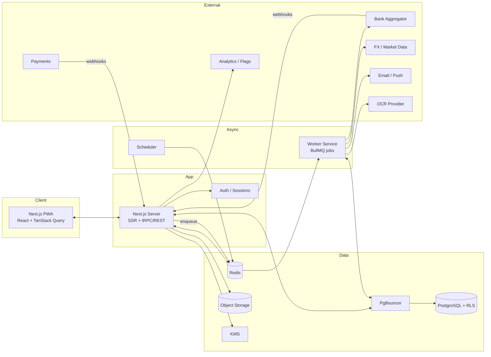

# Personal Finance Management Web App: Project Plan

> **Working title:** Ledgerly (placeholder, rename freely)
> **Type:** Responsive web app / installable PWA
> **Plan date:** 24 Oct 2026
> **Status:** Draft v2, revised after a gap review of v1

**Markers used in this document**
`[DECISION]` settled for now, change via ADR · `[ASSUMPTION]` believed but unverified, validate · `[OWNER INPUT]` cannot be resolved by this plan, needs a person or vendor · `[ESTIMATE]` order-of-magnitude figure, replace with quotes or actuals

**What changed from v1:** added market and differentiation analysis, a validation and go-to-market plan, a cost, team and capacity model, non-functional targets, finance-domain features (pending/posted, refunds, statement cycles, amortization, sinking funds, safe-to-spend), acceptance criteria for P0 features, categorization cold-start strategy, legal and retention policy, operations (incident response, support, vendor exit), analytics taxonomy, and a revised roadmap with bank sync pulled forward, explicit phase gates, and a buffer. Fixed the health-score scheduling inconsistency and the metrics-without-baselines gap.

---

## Contents
1. Vision & Goals
2. Market Context & Differentiation
3. Validation Plan & Go-to-Market
4. Target Users & Personas
5. Feature Catalog
6. User Flows, Acceptance Criteria & UX Policies
7. Technical Architecture
8. Non-Functional Requirements & Capacity
9. Data Model
10. Domain Logic, Policies & Categorization Strategy
11. API Design
12. Security, Privacy, Legal & Compliance
13. UX & Design Plan
14. Roadmap, Gates & Scope-Cut List
15. Team, Capacity, Budget & Unit Economics
16. Quality Strategy
17. DevOps, Operations & Support
18. Analytics & Experimentation
19. Monetization
20. Risks & Mitigations
21. Owner-Input Register & Open Questions
22. Immediate Next Steps
23. Sources

---

## 1. Vision & Goals

### 1.1 Vision
Give everyday people one calm, trustworthy place to see where their money goes, plan where it should go, and build better habits, without needing a finance degree or a spreadsheet.

### 1.2 Product goals
1. **Clarity:** a user sees their full financial picture (cash, debts, investments, net worth) in under 10 seconds after login.
2. **Control:** budgets, goals, and bill reminders that actively prevent overspending and missed payments.
3. **Automation:** minimize manual entry through imports, bank sync, rules, and (later) receipt scanning.
4. **Insight:** turn raw transactions into plain-language, explainable guidance.
5. **Trust:** bank-grade security, transparent privacy, and full data portability.

### 1.3 Non-goals (v1)
- Moving money, paying bills, or executing trades (read-only aggregation and tracking only).
- Personalized investment, tax, or legal advice (information and tools only).
- Native iOS/Android apps (PWA first; see 21 for the SMS-ingestion trade-off).
- Business/accounting features (invoicing, payroll, GST/VAT filing).

### 1.4 Success metrics and instrumentation
Targets below are **hypotheses**. They are re-baselined after the private alpha (Gate G1) using real data. Every metric has an instrumentation source from Phase 1 day one (event names in 18).

| Metric | Initial target (6 months post-launch) | Instrumentation source |
|---|---|---|
| Activation: first account + ≥10 transactions within 24 h | ≥ 60% | `account_created`, `transaction_created`, `import_completed` |
| Week-4 retention | ≥ 35% | `session_started` cohorts |
| Users with ≥1 active budget | ≥ 50% | `budget_created`, budget table snapshot |
| Auto-categorization accuracy | ≥ 90% top-1 on the gold set (see 10.4) | Gold-set eval job + `suggestion_accepted/rejected` |
| Suggestion acceptance rate | ≥ 80% | `suggestion_*` events |
| Free → paid conversion | 4–8% of activated users `[ASSUMPTION]` | billing events |
| Bank-sync success rate | ≥ 95% of sync runs | `sync_runs` table |
| p95 dashboard load | < 1.5 s | RUM (web vitals) |
| Critical security incidents | 0 | incident log |

---

## 2. Market Context & Differentiation

### 2.1 Landscape (Oct 2026)
Pricing and positioning below come from third-party roundups gathered in Oct 2026 and are **not verified against vendor sites** (see 23). Re-check before using any figure externally.

| Product | Positioning | Reported price | Free tier | Notable gaps / complaints |
|---|---|---|---|---|
| **YNAB** | Hands-on zero-based budgeting | ≈ $109/yr | No | Manual daily categorizing; price; assumes steady income |
| **Monarch Money** | Household dashboard, couples, investments | ≈ $100/yr (Core) | No | Reported desktop-only budget forecast; no free plan |
| **Copilot Money** | Polished UX, strongest on Apple devices | ≈ $95/yr | No | Platform-centric; single-user leaning |
| **Simplifi (Quicken)** | Automated spending plan | ≈ $36–72/yr (promo vs. list) | No | Less budgeting depth |
| **Rocket Money** | Subscription management, expense tracking | Freemium (not verified) | Yes | Subscription-creep and cancellation complaints in reviews |
| **Tiller** | Spreadsheet-based, power users | ≈ $108/yr | No | Requires spreadsheet skills |
| **Actual Budget** | Free, open-source, local-first envelope budgeting, self-hostable | Free (self-host) | Yes | Multi-currency experimental; no investment holdings; bank sync is an add-on |
| **Firefly III** | Self-hosted double-entry accounting | Free (self-host) | Yes | Accounting-first UX; heavier setup |
| **Sure** (fork of Maybe) | Self-hosted all-in-one dashboard | Free self-host; hosted ≈ $0/$5/$9 per month | Yes | Smaller ecosystem |
| **Mint** | Shut down 1 Jan 2024 | n/a | n/a | Left a large unmet "free tracker" audience |

### 2.2 Observed gaps (our opportunity)
1. **No permanent free tier among the leading paid apps.** Free alternatives are self-hosted and technical, so a polished, generous, hosted free tier is open ground.
2. **Privacy.** A 2026 Incogni study, as reported by a third party, found about 60% of the top-20 budgeting apps share financial data with third parties. A credible privacy-first position is differentiating, but it only works if every claim is true (see 12).
3. **Variable income and multi-currency** are weakly served. Reviewers note tools assume a steady paycheck, and Actual's multi-currency is still experimental.
4. **Sync reliability and subscription creep** are recurring complaint themes in review analyses.
5. **Region coverage.** Incumbents are mostly US-centric and USD-priced, so non-US markets are underserved. Bank-aggregation coverage is the constraint (see 15 and 21).

### 2.3 Positioning hypothesis `[ASSUMPTION]`
> *The privacy-first money app for people with real-world finances (variable income, multiple currencies, shared households) with a free tier that is actually useful.*

Pick **one** primary wedge after Phase 0 validation. Candidates: (a) free + privacy, (b) variable income + multi-currency, (c) couples and households. The roadmap protects all three but cuts in this priority order if forced.

### 2.4 Differentiators to build
| Differentiator | How it shows up in the product | Phase |
|---|---|---|
| Useful free tier | Manual accounts, imports, budgets, goals, basic reports with no time limit | 1 |
| Privacy by design | No data sales, read-only access, privacy mode, no financial values in analytics, one-click export and delete, public sub-processor list | 0–4 |
| Switch-friendly | Importers for YNAB, Mint-style CSV, Monarch CSV, Actual, Firefly III exports, with saved mappings | 2 |
| Variable-income mode | Budget from income received, tax set-aside percentage, irregular-expense sinking funds | 3 |
| Multi-currency first-class | Per-transaction FX with a documented historical-rate policy (10.3) | 3 |
| "Safe to spend" | One number answering "what can I spend until next income?" | 3 |
| Explainable insights | Every insight links to the transactions behind it; no invented numbers | 3 |

### 2.5 Competitive risks
Incumbents can add free tiers, drop prices, or ship privacy features. Our moat is the combination of free tier, privacy, variable income, and switching ease, plus execution quality. Re-run this analysis at every phase gate.

---

## 3. Validation Plan & Go-to-Market

### 3.1 Riskiest assumptions
| # | Assumption | How we test | Evidence needed to proceed |
|---|---|---|---|
| A1 | People will adopt without bank sync if import and manual entry are smooth | Concierge test + prototype tests | ≥ 50% of test users complete import → budget unaided |
| A2 | Enough users will pay for Plus (sync, forecast, etc.) | Pricing smoke test on landing page + interviews | Click-to-pay-intent ≥ 3% of visitors, and ≥ 5 of 20 interviewees name a price in range |
| A3 | Privacy and free-tier positioning resonates | Message tests on landing page variants | Waitlist conversion ≥ 15% on best variant |
| A4 | Categorization is good enough with rules and a small model | Gold-set evaluation (10.4) | ≥ 85% top-1 before beta |
| A5 | Bank aggregation is available and affordable in the first region | Provider sandbox + quote | Written quote and approval path by end of Phase 0 |

All thresholds are initial targets `[ASSUMPTION]` and should be adjusted by the owner before experiments start.

### 3.2 Research and experiments (Phase 0, weeks 1–3, in parallel with engineering setup)
1. **15–20 interviews** across four groups: Mint refugees/switchers, freelancers, couples/households, people who quit budgeting apps. Script covers current tools, money-day routine, trust and privacy, willingness to pay.
2. **Landing page + waitlist** with 2–3 positioning variants (free/privacy, variable income, household). Track visit → signup → pricing-click.
3. **Clickable prototype tests**, 5–8 users per round, 2 rounds: onboarding → import → budget; quick-add; dashboard comprehension (the 10-second test).
4. **Concierge MVP:** take 5–10 volunteers' CSV exports, produce a manual budget report, observe reactions.
5. **Pricing smoke test:** show Free/Plus/Family tiers with a "reserve at this price" button, no charge.

### 3.3 Go / no-go criteria at Gate G0
- A1–A3 evidence thresholds met, or a documented decision to proceed with a changed wedge.
- A5: first-region aggregator path confirmed (approval route, quote, timeline).
- Counsel engaged, and no legal blockers identified for the first region.

### 3.4 Go-to-market
| Area | Plan |
|---|---|
| **Messaging pillars** | Privacy you can verify · free tier that works · built for real-world income · switch in minutes |
| **Acquisition channels** | SEO content for "alternative to …" and "import from …" guides; honest participation in personal-finance communities (no spam, disclose affiliation); creator and finance-educator partnerships; public roadmap and changelog; referral rewards (extra history or features, never cash) |
| **Launch sequence** | Waitlist → private alpha (10–20) → closed beta (100–300) → open beta (1–2k) → public launch |
| **Onboarding emails** | Day 0 welcome + import guide · Day 2 "set your first budget" · Day 7 weekly recap · Day 14 sync/upgrade offer for Plus (only if relevant) |
| **Pricing page** | Transparent, annual and monthly, no dark patterns, one-click cancel (see 19) |
| **Success measures** | Waitlist → alpha conversion, CAC by channel, activation, week-4 retention |

---

## 4. Target Users & Personas

| Persona | Needs | Key features |
|---|---|---|
| **Priya, young professional** (25–32) | Stop month-end surprises, start saving, understand subscriptions | Budgets, subscription detection, goals, safe-to-spend |
| **Marcus, family manager** (33–45) | Shared household budget, bills, debt paydown | Shared workspaces, bill calendar, debt planner |
| **Elena, freelancer** | Irregular income, tax set-aside, multi-currency | Variable-income mode, tags, sinking funds, FX |
| **Sam, investor-curious** | Net worth across accounts and assets | Net worth, manual assets, allocation (later) |
| **Jordan, switcher** | Leaving another app without losing history | Importers, saved mappings, category mapping |

---

## 5. Feature Catalog

**Priority legend:** **P0** = MVP (Phase 1) · **P1** = launch-complete (Phases 2–3) · **P2** = post-launch v1.1+. A P2 item is never silently scheduled before launch; moving one up requires an equal cut elsewhere (see 14.4).

### 5.1 Accounts & Money Sources
| Feature | Priority |
|---|---|
| Manual accounts: checking, savings, cash, credit card, loan, wallet | P0 |
| Account balances with reconciliation (mark transactions reconciled) | P1 |
| Bank connection via aggregator (read-only) with auto-sync and reconnect flows | P1 |
| Sync health UI (last synced, errors, reconnect) | P1 |
| Account archiving, ordering, icons/colors | P1 |
| Multi-currency accounts with daily exchange rates | P1 |
| Manual assets and liabilities (property, vehicle, mortgage, student loan) | P1 |
| **Credit-card statement cycles:** closing day, due day, statement vs. current balance, "pay statement balance" reminder, utilization at statement date | P1 |
| **Loan amortization:** schedule with principal/interest split, extra payments, payoff date | P1 |

### 5.2 Transactions
| Feature | Priority |
|---|---|
| Add/edit/delete income, expense, transfer | P0 |
| Search, filter (date, amount, category, account, tag, merchant), sort | P0 |
| CSV import with column mapping, saved mappings, duplicate detection | P0 |
| OFX/QIF import | P1 |
| **Migration importers** (YNAB, Mint-style CSV, Monarch CSV, Actual, Firefly III) with category mapping | P1 |
| **Pending vs. posted:** pending shown with a badge, replaced on posting, no duplicates | P1 |
| **Refunds:** link a refund to its original; net spend by category | P1 |
| **Reimbursements:** mark an expense reimbursable, track expected vs. received, exclude reimbursed share from budgets | P1 |
| Split transactions across categories | P1 |
| Tags, notes, attachments (receipts) | P1 |
| Bulk edit (recategorize, tag, delete) | P1 |
| Auto-categorization: rules → merchant memory → model suggestions (10.4) | P1 |
| Merchant cleanup ("AMZN MKTP US*2K4" → "Amazon") | P1 |
| Undo/restore (soft delete, 30-day recovery) | P1 |
| Receipt OCR (merchant, date, total, line items) | P2 |
| Forwarded-email ingestion (receipts, bank alert emails) via a per-workspace address | P2 |
| Gross vs. net income entries (tax withheld, deductions) | P2 |

### 5.3 Budgeting & Planning
| Feature | Priority |
|---|---|
| Monthly category budgets with progress and "left to spend" | P0 |
| Budget period configurable by start day (e.g., payday) | P1 |
| Rollover policies (none / carry surplus / carry both / reset) | P1 |
| Templates: 50/30/20, zero-based, envelope | P1 |
| Alerts at 50/80/100% | P1 |
| Budget vs. actual across months | P1 |
| **Sinking funds** for irregular expenses (annual insurance, travel) with monthly set-aside | P1 |
| **Variable-income mode:** budget from income received, tax set-aside percentage | P1 |
| **Safe to spend:** spendable amount until next expected income (definition in 10.3) | P1 |

### 5.4 Goals & Savings
| Feature | Priority |
|---|---|
| Savings goals (target, date, linked account) | P0 |
| Required monthly contribution auto-calculated | P1 |
| Goal types (emergency fund, vacation, down payment, retirement, custom) | P1 |
| Milestones and progress timeline | P2 |
| What-if simulator | P2 |

### 5.5 Bills, Recurring & Subscriptions
| Feature | Priority |
|---|---|
| Recurring transactions with flexible schedules | P1 |
| Bill calendar and upcoming-bills widget | P1 |
| Reminders (email, web push, in-app) per notification policy (6.4) | P1 |
| Paid/unpaid tracking | P1 |
| Automatic subscription detection | P1 |
| Subscription dashboard (monthly/annual cost, price-hike detection, cancel-reminder) | P2 |

### 5.6 Debt Management
| Feature | Priority |
|---|---|
| Debt tracker (balance, APR, minimum payment, due date) | P1 |
| Payoff planner: avalanche vs. snowball with payoff date and interest saved | P1 |
| Extra-payment simulator | P2 |
| Credit utilization tracker | P2 |

### 5.7 Net Worth & Investments
| Feature | Priority |
|---|---|
| Net worth dashboard with history (manual assets and liabilities, account balances) | P1 |
| Manual holdings tracker (stocks, funds, crypto, gold, deposits) | P2 |
| Price sync from a market-data provider | P2 |
| Allocation charts, gain/loss, XIRR | P2 |
| Retirement / FIRE calculator | P2 |

### 5.8 Reports, Insights & Forecasting
| Feature | Priority |
|---|---|
| Dashboard: cash flow, spending by category, top merchants, upcoming bills, safe-to-spend | P0 (basic) / P1 (full) |
| Reports: income vs. expense, category and merchant trends, custom ranges, export PDF/CSV | P1 |
| Cash-flow forecast (30/60/90 days) | P1 |
| Rule-based, explainable insights | P1 |
| Anomaly detection (duplicate charges, unusual amounts) | P2 |
| Monthly recap | P2 |
| Financial health score with explainable factors | **P2 (post-launch; moved out of Phase 4 to remove overload)** |
| AI assistant over the user's own data | P2 |

### 5.9 Collaboration
| Feature | Priority |
|---|---|
| Shared workspaces with roles (owner/editor/viewer) | P2 `*` |
| Shared vs. private accounts | P2 `*` |
| Split expenses with friends, settle-up | P2 |
| Activity log / audit trail (user-visible) | P2 |

`*` The data model supports workspaces and memberships from day one, so enabling sharing is cheap. **Decision gate:** if Phase 0 research shows households are the core wedge (2.3), swap shared workspaces into Phase 3 (14.4 lists what to cut).

### 5.10 Platform Features
| Feature | Priority |
|---|---|
| Email/password + OAuth (Google, Apple), email verification | P0 |
| MFA (TOTP, passkeys/WebAuthn) and account recovery (6.5) | P1 |
| Dark/light/system themes, WCAG 2.2 AA | P0 |
| Installable PWA, offline read, queued writes (8.4) | P1 |
| Data export (CSV, JSON, PDF) and account deletion | P0 |
| Notifications center and preferences | P1 |
| i18n-ready, locale-aware currency/date/number formatting | P1 |
| Privacy mode (mask balances) | P1 |
| Onboarding wizard with demo data | P1 |
| Help center, in-app feedback with diagnostics bundle (17.4) | P1 |
| Public changelog and roadmap | P1 |
| Subscription billing for paid tiers | P1 |
| Documents vault (insurance, warranties, tax docs with expiry reminders) | P2 |
| Public API with personal access tokens | P2 |

---

## 6. User Flows, Acceptance Criteria & UX Policies

### 6.1 Key flows
1. **Onboarding:** sign up → verify email → currency/locale/timezone → add first account (manual / import / connect) → budget template → populated dashboard.
2. **Quick add:** global shortcut (`N`) or FAB → amount → category (suggested) → account → save in under 5 s.
3. **Import:** upload → map columns (remembered per account) → preview with duplicates flagged → confirm → rules categorize.
4. **Monthly cycle:** setup or rollover → mid-month alerts → end-of-month recap and adjustments.
5. **Goal funding:** create goal → see required monthly amount → link recurring transfer → track.
6. **Debt payoff:** add debts → choose strategy → timeline and interest saved → mark payments.
7. **Switching:** choose source app → upload export → category mapping review → history appears with a "what we imported" summary.

### 6.2 P0 user stories and acceptance criteria (Given/When/Then)

| ID | Story | Acceptance criteria |
|---|---|---|
| **US-01** Sign up | As a new user I can create an account and verify my email | **Given** a valid email and strong password, **when** I submit, **then** I get a verification email within 60 s and cannot access data until verified. **Given** an already-registered email, **then** the response does not reveal that it exists. Password rules and rate limits enforced; OAuth sign-in creates the same account type. |
| **US-02** Add account | I can add manual accounts with an opening balance | **Given** the account form, **when** I save, **then** the account appears with the correct balance, currency, and type. Archiving hides it from totals but keeps history. |
| **US-03** Add transaction | I can record income, expense, or transfer | **Given** amount, date, account and category, **when** I save, **then** balances update immediately. Transfers create two linked entries that net to zero. Editing an amount updates balances and writes an audit entry. Negative and zero amounts are validated by type. |
| **US-04** Import CSV | I can import a bank CSV | **Given** a CSV up to 10,000 rows, **when** I map columns and confirm, **then** rows import in under 60 s, duplicates (same account, date ±1 day, amount, normalized description) are flagged not auto-deleted, and re-importing the same file adds zero rows. A failed row reports its line number and reason, and good rows still import. |
| **US-05** Categories | I can use default and custom categories | **Given** the default set, **when** I add, rename, or archive a category, **then** historical transactions keep their category; deleting a category forces reassignment. |
| **US-06** Budget | I can set a monthly budget per category | **Given** budgeted categories, **when** transactions post, **then** progress bars show spent, remaining, and over-budget states. Month switching keeps previous months intact. Transfers never count as spending. |
| **US-07** Goal | I can create a savings goal | **Given** a target and date, **when** I add contributions, **then** progress and projected completion update. A goal can link to one account. |
| **US-08** Dashboard | I can see my situation at a glance | **Given** at least one account, **then** the dashboard shows cash flow, spending by category, and recent transactions, loads under the 1.5 s p95 budget, and shows a useful empty state with a next action when there is no data. |
| **US-09** Export | I can export all my data | **When** I request export, **then** a ZIP (CSV + JSON) is ready within 15 min with a download link valid for 24 h, containing every transaction, account, category, budget, and goal. |
| **US-10** Delete account | I can permanently delete my account | **When** I confirm (re-authentication required), **then** I get a 14-day grace period with a cancel link, after which data is deleted per the retention matrix (12.4) and a confirmation email is sent. |

P1 features get stories and criteria written during the phase's planning, using the same format, before development starts (Definition of Ready, 16).

### 6.3 Empty and error states (minimum set)
| Screen | Empty state | Error state |
|---|---|---|
| Dashboard | "Add your first account" with three paths (manual, import, connect) and a demo-data toggle | Per-widget error with retry; the rest of the page still renders |
| Transactions | "No transactions yet. Import a file or add one" | Inline retry; keep filters; never lose unsaved edits |
| Import | Template download and format help | Row-level errors listed with line numbers; partial success allowed |
| Budget | "Start from a template" | Calculation failure shows the last good snapshot with a stale badge |
| Bank connection | "Connect an account (read-only)" with privacy explanation | Clear reason (credentials, institution outage, consent expired) and a reconnect button; manual and import remain available |
| Reports | "Not enough data yet. Reports need about 2 weeks of history" | Retry; export still available |
| Offline | Cached read-only data with an "offline" banner | Queued writes shown as "pending sync" with a conflict inbox (8.4) |

### 6.4 Notification policy
| Rule | Policy |
|---|---|
| Categories | Security (always on) · Bills · Budgets · Goals · Sync issues · Weekly/monthly recap (opt-in) · Product news (opt-in) |
| Channels | In-app, email, web push. Push requires opt-in. iOS web push works only for installed PWAs, so email is the fallback |
| Defaults | Bill reminders 3 days before and on the due day · Budget alerts once per threshold per period · Sync issues once per failure episode |
| Frequency caps | Max 1 non-critical push per day, max 3 emails per week excluding security and bills |
| Quiet hours | 21:00–08:00 workspace local time for push; email unaffected |
| Preferences | Per category and channel, one-click email unsubscribe, honors consent records |
| Delivery | Push → email fallback if undelivered in 15 min for bills only. All sends logged for debugging without storing financial values in third-party systems |
| Marketing | Only with explicit consent, separable from product notifications |

### 6.5 Account recovery
| Scenario | Flow |
|---|---|
| Forgot password | Email link, single-use, 30-minute expiry, revokes all sessions on use, notifies of the change |
| Lost MFA device | 10 single-use recovery codes issued at enrollment (prompt to store). If lost: passkey fallback if enrolled, else a recovery request with email verification and a **72-hour delay**, notifications on all channels with a cancel link, then MFA reset |
| Lost email access | Support-assisted process with identity checks defined in the support runbook; no bypass without two independent verification factors; always audited |
| Compromised account | Self-service "sign out everywhere", session list, security email with one-click lock |
| Support access to data | Never by default. Time-boxed, user-consented impersonation with a visible banner and audit entry (17.4) |

Note: data is encrypted at rest but not end-to-end, which is what makes recovery possible `[DECISION]`.

---

## 7. Technical Architecture

### 7.1 Recommended stack
| Layer | Choice | Rationale |
|---|---|---|
| Language | **TypeScript** end to end | Shared types, one language |
| Frontend | **Next.js (App Router) + React** | SSR/streaming, PWA-capable |
| UI | Tailwind CSS + shadcn/ui (Radix) | Accessible primitives |
| Charts | Recharts (visx for custom) | Declarative |
| Client data | TanStack Query, React Hook Form + Zod | Caching, optimistic updates, validation |
| API | **tRPC** (internal) + REST/OpenAPI (webhooks, future public API) | Type safety |
| Backend | Node.js (route handlers) + separate worker service | Shared code, async jobs |
| Database | **PostgreSQL** with PgBouncer (transaction pooling) | Relational integrity for money |
| ORM | Drizzle (or Prisma) | Type-safe migrations |
| Cache/queues | Redis + BullMQ | Jobs, rate limiting |
| Files | S3-compatible storage | Receipts, exports |
| Auth | Auth.js or Clerk, with WebAuthn | Don't hand-roll auth |
| Bank aggregation | Pluggable adapter: Plaid (US/CA/EU/UK), regional providers elsewhere | Region-specific, abstract it |
| FX / market data | Provider adapter, cached daily | Swappable |
| Email / push | Resend or Postmark; Web Push (VAPID) | Reminders |
| Product analytics + flags | PostHog (self-hostable) or GrowthBook + OpenFeature | Flags, experiments, funnels (see 18) |
| OCR (P2) | Cloud OCR or Tesseract fallback | Receipts |
| Observability | OpenTelemetry, Sentry, Grafana/Prometheus or managed APM | Errors, traces, SLOs |
| Hosting | Vercel or Fly.io/Render + managed Postgres (Neon/Supabase/RDS) | Low-ops start |
| CI/CD | GitHub Actions | Tests, migrations, previews |
| Testing | Vitest, RTL, Playwright, k6 | Unit → E2E → load |

Every layer is replaceable. Invariants: Postgres, shared TypeScript types, provider adapters, integer money `[DECISION]`.

### 7.2 High-level architecture



### 7.3 Design principles
- **Money as integers:** `BIGINT` minor units plus ISO-4217 `currency`. No floats. One `Money` module with a decimal library.
- **Append-mostly ledger:** edits write audit entries; deletes are soft.
- **Paired transfers:** two linked entries so balances always reconcile.
- **Idempotent imports and syncs:** deterministic `external_id`/hash per row.
- **Adapters for externals:** aggregator, FX, market data, OCR, email, payments, analytics sit behind interfaces (exit plan in 17.6).
- **Multi-tenant by workspace:** every row carries `workspace_id`, enforced by app checks **and** Postgres RLS.
- **Background by default:** syncs, recalculations, forecasts, reports run as jobs; UI reads precomputed aggregates.
- **Feature flags for anything risky or unfinished;** expand/contract migrations only.

### 7.4 Repo structure
```
ledgerly/
├─ apps/
│  ├─ web/                # Next.js (UI + API routes)
│  └─ worker/             # BullMQ workers + scheduler
├─ packages/
│  ├─ db/                 # schema, migrations, seed, RLS policies
│  ├─ core/               # money, budgets, forecasting, debt payoff, amortization
│  ├─ integrations/       # aggregator / fx / market / ocr / email adapters
│  ├─ categorization/     # rules, merchant dictionary, model, gold-set eval
│  ├─ ui/                 # shared components
│  ├─ config/             # eslint, tsconfig, tailwind presets
│  └─ validators/         # shared Zod schemas
├─ infra/                 # Docker, IaC, CI workflows
├─ docs/                  # ADRs, API docs, runbooks, threat models
└─ plan.md
```

---

## 8. Non-Functional Requirements & Capacity

### 8.1 Capacity assumptions `[ASSUMPTION]`
| Dimension | Launch | 12-month stretch |
|---|---|---|
| Registered users | 10k | 50k |
| Monthly active users | 5k | 25k |
| Transactions per user (with imported history) | avg 3k, p99 100k | same |
| Total transaction rows | ~30M | ~150M (plan hash-partitioning by `workspace_id`; not needed at launch) |
| Bank connections per paying user | avg 2.5 | avg 2.5 |
| Sync runs per day | ≤ 3 per connection → ≈ 4 per second average at stretch | same |
| API load | 100 req/s sustained, 500 req/s burst | 3× |
| Attachment storage | free tier cap 50 MB/user; paid 2 GB | |

### 8.2 Performance budgets
| Area | Budget |
|---|---|
| Dashboard | p95 server response < 1.5 s; LCP < 2.5 s on mid-tier mobile over 4G |
| API reads / writes | p95 < 300 ms / < 500 ms |
| Search | p95 < 400 ms |
| CSV import | 10,000 rows in < 60 s |
| Initial JS (per route) | < 200 KB gzipped |
| Interaction | INP < 200 ms, CLS < 0.1 |
| Lists | Virtualized beyond 200 rows |

### 8.3 Reliability, recovery, compatibility
- Availability 99.9% (web app); sync success ≥ 95%; reminder delivery within 5 min of schedule.
- **RPO ≤ 15 min, RTO ≤ 4 h**, with a restore drill before launch and quarterly after.
- Browsers: last 2 versions of Chrome, Edge, Firefox, Safari; iOS Safari 16.4+ for installed-PWA push.
- Accessibility: WCAG 2.2 AA.

### 8.4 Offline and conflict policy
| Case | Rule |
|---|---|
| Offline reads | IndexedDB cache of the last 90 days of transactions, current budgets, goals, accounts |
| Queued writes | Idempotent mutations with client-generated UUIDv7 ids and a `row_version` |
| Creates | Append-only, no conflict possible |
| Edits | Field-level last-writer-wins on non-financial fields (notes, tags, category). Edits to amount, date, or account that conflict go to a **"needs review" inbox** instead of being silently overwritten |
| Deletes | Tombstone wins over edits; restorable for 30 days |
| Sync status | Visible "pending sync" state; no offline access to attachments or reports beyond cache |

### 8.5 Search
Postgres full-text plus `pg_trgm` for merchant and notes at launch. Revisit dedicated search (Meilisearch/OpenSearch) if search p95 exceeds 400 ms or rows exceed about 50M.

---

## 9. Data Model (core entities)

```
users(id, email, name, locale, base_currency, created_at, ...)
workspaces(id, name, owner_id, timezone, month_start_day, base_currency, created_at)
memberships(workspace_id, user_id, role)                 -- owner | editor | viewer
consents(user_id, type, version, granted_at, revoked_at) -- terms, privacy, marketing, data-contribution

institutions(id, name, provider, provider_ref)
connections(id, workspace_id, institution_id, status, access_ref_encrypted, last_synced_at, consent_expires_at)
sync_runs(id, connection_id, started_at, finished_at, status, added, updated, error_code)
accounts(id, workspace_id, connection_id?, name, type, currency, opening_balance,
         is_archived, is_shared, sort_order,
         statement_close_day?, payment_due_day?, credit_limit?)

loan_terms(account_id, principal, apr, rate_type, term_months, start_date, payment_amount)
sinking_funds(id, workspace_id, category_id, target_amount, due_date, monthly_set_aside, balance)

categories(id, workspace_id, parent_id?, name, kind, icon, color)  -- income|expense|transfer
tags(id, workspace_id, name)
merchants(id, workspace_id, name, normalized_name, default_category_id?)

transactions(id, workspace_id, account_id,
             posted_date DATE,               -- civil date as shown by the bank (no timezone shift)
             occurred_at TIMESTAMPTZ?,       -- optional precise time
             amount, currency,
             base_amount, fx_rate_used,      -- frozen at write time (10.3)
             kind, status,                   -- status: pending | posted
             pending_of_id?,                 -- links a pending row to its posted replacement
             refund_of_id?,
             reimbursable BOOL, reimbursed_amount,
             merchant_id?, category_id?, notes,
             external_id?, import_batch_id?, transfer_pair_id?, recurring_id?,
             row_version, deleted_at?, created_by, created_at)
transaction_splits(id, transaction_id, category_id, amount, notes)
transaction_tags(transaction_id, tag_id)
attachments(id, transaction_id, storage_key, mime, size, ocr_json?)
documents(id, workspace_id, storage_key, kind, expires_on?)           -- P2

rules(id, workspace_id, priority, conditions_json, actions_json, is_active)
import_batches(id, workspace_id, account_id, source, mapping_json, row_count, created_at)
ingest_addresses(id, workspace_id, address, is_active)                -- P2

budgets(id, workspace_id, name, period, start_date, template, rollover_policy, mode) -- mode: fixed | variable_income
budget_items(id, budget_id, category_id, amount, rollover_balance)
goals(id, workspace_id, name, type, target_amount, target_date, linked_account_id?, current_amount, status)
goal_contributions(id, goal_id, transaction_id?, amount, date)

recurring_items(id, workspace_id, template_json, rrule, next_due, is_active, kind)
subscriptions(id, workspace_id, merchant_id, amount, cadence, next_charge, status, detected_at)
debts(id, workspace_id, account_id, apr, min_payment, due_day, strategy_priority)

holdings(id, workspace_id, account_id, symbol, asset_class, quantity, cost_basis, currency)     -- P2
prices(symbol, date, price, currency)                                                            -- P2
fx_rates(base, quote, date, rate)
net_worth_snapshots(id, workspace_id, date, assets, liabilities, net_worth, currency)

notifications(id, user_id, type, payload_json, read_at, channel, sent_at)
notification_prefs(user_id, category, channel, enabled)
insights(id, workspace_id, type, payload_json, period, created_at, dismissed_at?)
audit_log(id, workspace_id, actor_id, entity, entity_id, action, diff_json, at)
deletion_requests(id, user_id, requested_at, grace_until, completed_at?)
categorization_labels(id, source, text_redacted, label, region, split)   -- opt-in only, no user ids (10.4)
gold_set(id, text_redacted, label, region)                               -- evaluation only
```

**Indexes to plan early:** `(workspace_id, posted_date DESC)` and `(workspace_id, account_id, posted_date)` on transactions; unique `(account_id, external_id)`; GIN/trigram on merchant and notes.

**Derived data:** monthly category aggregates (materialized views or a summary table refreshed by jobs) power the dashboard and reports.

---

## 10. Domain Logic, Policies & Categorization Strategy

### 10.1 Algorithms
| Area | Approach |
|---|---|
| **Duplicate detection** | Hash of (account, date ±1 day, amount, normalized description) plus fuzzy match; flag for review, never auto-delete |
| **Pending → posted** | Match by provider `pending_transaction_id` first, then (account, amount, merchant, date window); replace the pending row, keep user edits (category, notes, tags) |
| **Transfer detection** | Opposite-sign amounts across accounts in a date window; propose linking |
| **Refund linking** | Same merchant, opposite sign, amount ≤ original within 90 days; propose linking, user confirms |
| **Subscription detection** | Cluster by merchant + near-constant amount + regular cadence with tolerance; require ≥ 3 occurrences |
| **Cash-flow forecast** | Current balance + scheduled recurring items + trailing-average variable spend by category; show optimistic/pessimistic band |
| **Debt payoff** | Month-by-month simulation; avalanche = highest APR first, snowball = smallest balance first; outputs payoff date, total interest, per-debt timeline |
| **Loan amortization** | Standard fixed-rate schedule with extra-payment support; variable-rate loans use manually updated rates and recompute forward |
| **Credit-card cycle** | Statement balance = charges through closing day; due-date reminders target the statement balance; utilization measured at statement date |
| **Budget rollover** | Per category: none / carry surplus / carry both / reset; sinking funds always carry |
| **Net worth** | Nightly snapshot job, on-demand for today, FX-converted at snapshot-date spot rate |
| **Insights engine** | Rule-based detectors produce structured insights, rendered with templates. An LLM may polish wording but never invents numbers, and every insight links to its source transactions |

### 10.2 Safe-to-spend definition `[DECISION]`
`safe_to_spend = spendable_balance − upcoming_bills_until_next_income − remaining_sinking_fund_set_asides_this_period − budgeted_essentials_not_yet_spent`
- *Spendable balance:* checking and cash accounts flagged "spending".
- *Next income:* next expected recurring income; if none, the end of the budget period.
- Shows the calculation breakdown on tap; never negative-shaming (copy says "over by …, here's how to adjust").

### 10.3 Time, date, and FX policy `[DECISION]`
| Topic | Policy |
|---|---|
| **Dates** | `posted_date` is a civil `DATE` exactly as the bank reports it, never converted through UTC. `occurred_at` is optional and stored as `TIMESTAMPTZ` |
| **Workspace timezone** | Used for budget periods, reminders, quiet hours, "today". Budget period boundaries use `month_start_day` in that timezone |
| **Recurring schedules** | RRULE evaluated on civil dates in the workspace timezone, DST-safe, month-end clamping (31st → last day) |
| **Transaction FX** | Original amount and currency are kept. `base_amount` and `fx_rate_used` are computed once at write time from the rate for `posted_date` (nearest prior business day if missing) and **frozen**, so historical reports don't drift |
| **Manual FX override** | User can set a rate per transaction; flagged as overridden |
| **Net worth FX** | Balances converted at the spot rate for the snapshot date |
| **Changing base currency** | Triggers a versioned recompute job; old reports remain reproducible via snapshot version |
| **Rounding** | Convert per transaction, round half-even to the currency's minor unit, never re-derive from totals |

### 10.4 Categorization strategy (cold start)
| Stage | Approach | Available at |
|---|---|---|
| **0: Deterministic** | (1) User rules by priority → (2) merchant memory (last category used) → (3) aggregator-provided enrichment/category where available → (4) card network merchant category code where present → (5) curated merchant dictionary (hand-built top ~2k merchants per launch region) and keyword rules | Phase 2 |
| **1: Model suggestions** | Small text classifier on redacted descriptions; show confidence; user corrections feed learning | Phase 3, only if it beats stage 0 on the gold set |
| **Auto-apply threshold** | Apply automatically only when confidence ≥ 0.9 **and** precision ≥ 95% on the gold set at that threshold; otherwise show as a suggestion | |

**Where labeled data comes from (cold start):**
1. **Team-labeled gold set:** ≥ 2,000 transactions, stratified by region, merchant frequency, and category, built from synthetic data plus alpha testers' **opt-in** contributions with descriptions redacted (account numbers, names, and addresses stripped). Used for evaluation only and never for training.
2. **Training labels:** opt-in de-identified user corrections (separate store, no user ids, see `categorization_labels`), plus human-reviewed LLM-assisted labeling on redacted text.
3. **Merchant dictionary** curated by the team per region.

**Evaluation:** top-1 accuracy, macro-F1, calibration; reported per region and per merchant-frequency bucket. **Targets:** ≥ 85% top-1 before beta, ≥ 90% at launch, measured on the gold set; plus in-product suggestion acceptance ≥ 80%.

**Privacy constraints:** raw descriptions are never sent to third-party LLMs without opt-in and redaction; prefer a self-hosted small model; data contribution is opt-in and revocable (revocation removes contributed rows from future training sets); contributed text is excluded from analytics and support tooling.

---

## 11. API Design

- **Internal:** tRPC routers per domain (`accounts`, `transactions`, `budgets`, `goals`, `recurring`, `reports`, `settings`), deployed atomically with the web app, so no versioning is needed.
- **External:** REST + OpenAPI under `/v1` for webhooks and the future public API (personal access tokens, scoped, rate-limited).
- **Versioning policy (public API):** additive changes within a version; breaking changes require a new version and a **12-month deprecation window** with `Deprecation`/`Sunset` headers and changelog notice.
- **Webhooks:** signed (HMAC), timestamped, replay-protected, retried with backoff, idempotent handlers.
- **Conventions:** cursor pagination; idempotency keys on retryable writes; consistent error shape (`code`, `message`, `fields`); ISO-8601 dates; amounts as `{ minor, currency }`.
- **Rate limiting:** per user and per IP via Redis; stricter on auth, import, and export.

---

## 12. Security, Privacy, Legal & Compliance

### 12.1 Security
- **Auth:** Argon2id hashing, secure cookie sessions (HttpOnly, SameSite, Secure), MFA (TOTP + passkeys), device/session management, login-anomaly emails.
- **Data protection:** TLS everywhere, encryption at rest, **envelope encryption** for aggregator tokens and sensitive fields.
- **Key management:** a data-encryption key (DEK) per workspace or connection, wrapped by a KMS key-encryption key (KEK). KEK auto-rotates annually; DEKs re-wrap lazily; application secrets rotate every 90 days; a compromised-key runbook exists and is drilled once before launch.
- **Row-level security with connection pooling:** because PgBouncer runs in transaction mode, tenant context is set with `SET LOCAL app.workspace_id` / `app.user_id` at the start of **every transaction**, never session-level `SET`. Workers use a separate scoped role and set context per job. Only the migration role bypasses RLS. Automated tests assert cross-tenant reads and writes fail.
- **Web hardening:** strict CSP, CSRF protection, Zod validation, output encoding, SRI for third-party scripts, dependency and secrets scanning.
- **Abuse protection:** rate limits, bot protection on sign-up, upload limits and malware scan for receipts and imports (type/size validation, CSV formula-injection sanitization on export).
- **Secure SDLC:** code review, SAST/DAST in CI, Renovate/Dependabot, threat model per major feature, external pen test before public launch, bug bounty after launch.
- **Backups and DR:** point-in-time recovery, tested restores (8.3).

### 12.2 Privacy (commitments the product must make true)
- Minimum data collection; plain-language privacy policy; public sub-processor list.
- **No financial values or merchant names in analytics, logs, or session replay** (replay disabled or fully masked on finance screens). Analytics events carry bucketed or categorical properties only.
- No sale of user data; aggregator access is read-only; users can disconnect any time and purge synced data.
- Full export and verified hard-delete (12.4).
- Marketing claims about privacy are reviewed against this list before publication.

### 12.3 Legal checklist `[OWNER INPUT: counsel review required]`
| Item | Notes | Needed by |
|---|---|---|
| Terms of Service | Includes "informational only, not financial/tax/legal advice", acceptable use, liability limits | Before alpha |
| Privacy Policy and cookie/consent notice | Consent for analytics and marketing, per-region requirements | Before alpha |
| Sub-processor DPAs | Hosting, database, email, analytics, aggregator, payments, OCR | Before beta |
| Aggregator end-user terms and consent disclosures | Provider-mandated consent flow and privacy policy language | Before production access |
| Age gating | 18+ (or local age of majority) at sign-up; no accounts for minors; terms say so | Before alpha |
| Data-subject request process | Access, export, correction, deletion, within statutory timelines | Before beta |
| Breach notification procedure | Legal clock (e.g., 72 h under GDPR) built into the incident runbook | Before beta |
| Payments | Hosted checkout so card data never touches our servers (minimal PCI scope); tax handling for digital services | Before billing |
| Regional rules | GDPR/UK-GDPR, CCPA/CPRA, India's DPDP Act, local open-banking regulation, per launch region | Phase 0 |
| Trademark and domain check for the final name | | Before public waitlist |

### 12.4 Retention vs. deletion matrix `[DECISION, confirm with counsel]`
| Data | Retention | Notes |
|---|---|---|
| Account and financial data | Deleted within 30 days of deletion request, after a 14-day grace period | Includes attachments and synced data; aggregator access revoked immediately |
| Backups | Purged on the backup rotation cycle, max 35 days | Documented in the privacy policy |
| Audit log | Financial content removed; actor pseudonymized; minimal security events (login, MFA, export, delete) kept up to 12 months | Resolves "hard delete vs. audit" conflict |
| Billing records | Per tax/accounting law (commonly multiple years), held by the payment processor and a minimal invoice record | Contains no financial-account data |
| Support tickets | 24 months, then deleted | Attachments with financial data are discouraged and auto-expire |
| Categorization contributions | Until revoked; removed from future training sets on revocation | No user ids stored |
| Analytics | Pseudonymous, 13 months | No financial values (12.2) |

### 12.5 SOC 2 path `[ASSUMPTION]`
Not required for a consumer launch, but aggregators may send security questionnaires at production approval and it builds trust. Plan: adopt a compliance-automation tool and written policies from the beta, target **Type I** within ~6 months after launch, **Type II** after a 6–12 month observation period. Revisit if B2B or partner channels appear.

---

## 13. UX & Design Plan

### 13.1 Principles
Calm and non-judgmental · glanceable · fast entry · progressive disclosure · accessible by default · mobile-first.

### 13.2 Information architecture
```
Dashboard
Transactions        (list, filters, import, rules)
Budgets             (budget, sinking funds)
Goals
Bills & Subscriptions
Debts & Loans
Net Worth
Reports & Insights
Accounts            (connections, manual accounts)
Settings            (profile, security, categories, tags, rules, notifications, privacy, export, billing)
```

### 13.3 Low-fidelity wireframes (starting point for design)

**Dashboard (desktop)**
```
┌────────────────────────────────────────────────────────────────────┐
│ ☰ Ledgerly            [ Search / ]   [ + Add  N ]   👁 Privacy  ◐  │
├───────────────┬────────────────────────────────────────────────────┤
│ Dashboard     │  Safe to spend      Net worth        This month    │
│ Transactions  │  ┌─────────────┐   ┌────────────┐   ┌────────────┐ │
│ Budgets       │  │  $ 412      │   │ $ 38,200   │   │ In  $4,100 │ │
│ Goals         │  │ until Nov 3 │   │ ▲ 2.1% mo  │   │ Out $3,380 │ │
│ Bills         │  └─────────────┘   └────────────┘   └────────────┘ │
│ Debts         │  Budget health  ◯◯◯◯ (rings by category)           │
│ Net worth     │  Spending by category  ▇▇▇▇▇  | Cash flow  ╱╲╱    │
│ Reports       │  Upcoming bills: Rent (3d) · Phone (6d)            │
│ Accounts      │  Recent transactions ……………………………………………         │
│ Settings      │  Insight: "Dining is 32% above your 3-mo avg" [why]│
└───────────────┴────────────────────────────────────────────────────┘
```

**Quick add (mobile)**
```
┌─────────────────────┐
│  Add transaction  ✕ │
│  [ Expense | Income | Transfer ]
│          $ 0.00      │  ← big numeric keypad
│  Merchant  [ search ]│
│  Category  ● Dining (suggested) ▾
│  Account   Checking ▾ │  Date Today ▾
│  + note  + tag  + receipt
│        [   Save   ]  │
└─────────────────────┘
```

### 13.4 Design system
Tokenized colors/spacing/typography, light and dark themes, color-blind-safe chart palettes, visible focus states, reduced-motion support, keyboard shortcuts (`N` new, `/` search, `G` then `D` dashboard), skeleton loaders, empty states with next actions, non-judgmental copy for overspending.

### 13.5 Accessibility
WCAG 2.2 AA target; semantic HTML; screen-reader-friendly charts with data-table alternatives; no information by color alone; axe in CI and manual screen-reader passes each phase; an external accessibility audit in Phase 4.

---

## 14. Roadmap, Gates & Scope-Cut List

Estimates assume ~3 engineers, 0.5 designer, 0.25 product owner (15). **Bank sync is now Phase 2** (it was Phase 4 in v1) because it is the biggest retention driver and aggregator approvals take calendar time, so procurement starts in Phase 0.

### 14.1 Phases
| Phase | Weeks | Theme | Exit gate |
|---|---|---|---|
| **0** | 1–3 | Foundations, validation, procurement | **G0** go/no-go |
| **1** | 4–10 | MVP core | **G1** private alpha |
| **2** | 11–18 | Connectivity & automation | **G2** closed beta |
| **3** | 19–26 | Planning & wealth | **G3** open beta |
| **4** | 27–32 | Hardening & launch | **G4** launch readiness |
| Buffer | 33–36 | Contingency (~12% of build time) and launch ramp | |
| v1.1+ | 37+ | Collaboration and intelligence | |

### 14.2 Phase detail

**Phase 0: Foundations, validation, procurement (Weeks 1–3)**
- Validation program (3.2): interviews, landing page + waitlist, prototype tests, concierge MVP, pricing smoke test.
- Procurement: aggregator sandbox and **production-access application for the first region**, quote requested; counsel engaged (12.3); accounts for email, payments (test mode), analytics/flags, error tracking, KMS.
- Engineering: monorepo, CI/CD, preview deploys, schema v0, **RLS + PgBouncer spike (12.1)**, auth skeleton, feature-flag and analytics pipeline with the event taxonomy (18), design tokens, ADRs (money, tenancy/RLS, auth, aggregator interface, offline conflicts), threat model v0.
- Data: start the categorization gold-set plan (10.4) and merchant dictionary seed.
- **G0:** validation thresholds met or wedge adjusted (3.3), aggregator path confirmed, legal blockers cleared.

**Phase 1: MVP core (Weeks 4–10)**
- P0 features (5) with acceptance criteria US-01…US-10 passing.
- Workspaces from day 1, instrumentation from day 1 (baseline metrics start accruing).
- Accessibility baseline, dark mode, data export and deletion, demo data.
- Private alpha with 10–20 users from the waitlist.
- **G1:** every P0 story passes; zero data-integrity bugs (balance/transfer invariants); ≥ 80% of alpha testers complete import → budget unaided; metrics **re-baselined**; critical feedback triaged.

**Phase 2: Connectivity & automation (Weeks 11–18)**
- Bank aggregation for the first region, sync-health tooling, reconnect flows, webhooks, pending/posted handling, transfer detection.
- Rules engine, merchant normalization, categorization stage 0, gold-set evaluation job.
- Recurring items, bill calendar, reminders, notification center and policy (6.4).
- Migration importers (YNAB, Mint-style CSV, Monarch CSV, Actual, Firefly III), OFX/QIF.
- PWA install + offline read, MFA, passkeys, account recovery (6.5).
- Support tooling, help center v1, status page, on-call rotation (business hours) (17).
- Closed beta (100–300 users).
- **G2:** sync success ≥ 95%; categorization ≥ 85% top-1 on the gold set; no open critical/high security findings; support response SLA met for beta.

**Phase 3: Planning & wealth (Weeks 19–26)**
- Budget rollover, templates, alerts, custom period start, **variable-income mode**, **sinking funds**, **safe-to-spend**.
- Debt tracker and planner, **loan amortization**, **credit-card statement cycles**.
- Net worth with manual assets and liabilities, nightly snapshots.
- Multi-currency with the FX policy (10.3).
- Subscription detection, cash-flow forecast, reports v1, insights engine v1 (rule-based), privacy mode.
- Splits, attachments, bulk edit, undo, refunds, reimbursements.
- Categorization stage 1 (only if it beats stage 0 on the gold set).
- Remaining P1 items not named above: account reconciliation, account archiving/ordering/icons, goal enhancements (required monthly contribution, goal types), budget vs. actual across months, locale/i18n readiness, public changelog and roadmap.
- Open beta (1–2k users).
- **G3:** forecast within ±10% on test datasets; insights fact-checked; Lighthouse and a11y budgets met; paid-tier willingness to pay confirmed on real usage.

**Phase 4: Hardening & launch (Weeks 27–32)**
- External pen test and remediation; accessibility audit; load test to the 8.1 profile; DR restore drill; key-compromise drill.
- Billing and paywall (hosted checkout), legal pages finalized, sub-processor list public.
- Deletion verification (end to end, including backups policy), data-subject-request runbook rehearsal.
- Launch plan execution (3.4), analytics dashboards, 24/7 best-effort paging for SEV1.
- **G4 launch readiness checklist:** security sign-off · SLOs defined and monitored · incident and breach runbooks rehearsed · support ready · legal approved · load and DR targets met · rollback plan tested.

**Buffer (Weeks 33–36):** absorbs slippage, launch fixes, and staged rollout.

### 14.3 Post-launch v1.1+ backlog (in rough order)
1. Collaboration: shared workspaces, roles, shared/private accounts, split expenses, user-visible activity log (earlier if the household wedge wins, 5.9).
2. Receipt OCR and forwarded-email ingestion.
3. Anomaly detection, monthly recap, financial health score.
4. Manual holdings tracker, price sync, allocation, XIRR, FIRE planner.
5. Subscription cancel-reminders, what-if simulator, extra-payment simulator, credit-utilization tracker.
6. AI assistant over user data (privacy review first), public API, documents vault, tax exports.
7. Native apps (needed for SMS-based ingestion; see 21).

### 14.4 Scope-cut list (if capacity slips)
Cut in this order, protecting the core loop (import/sync → categorize → budget → dashboard) and the chosen wedge:
1. Categorization stage 1 (model), keep stage 0.
2. Insights engine v1 beyond three detectors (overspend, subscription, large-change).
3. Credit-card statement cycles and loan amortization (keep simple debt tracker).
4. Reimbursements and refund linking (keep manual notes).
5. OFX/QIF and secondary migration importers (keep CSV + YNAB).
6. Forecast band (keep point forecast).
7. Net worth history charts (keep current net worth).
8. Variable-income mode **only if** the wedge is not variable income.

**Swap rule:** pulling any item forward (for example shared workspaces) must name what it displaces from this list.

---

## 15. Team, Capacity, Budget & Unit Economics

### 15.1 Team `[OWNER INPUT]`
| Role | Allocation | Notes |
|---|---|---|
| Full-stack engineers | 3 FTE | One with finance-domain/data strength, one strong on frontend/design system |
| Product designer | 0.5 FTE | Phase 0–2 heavier |
| Product owner / founder | 0.25–0.5 FTE | Research, prioritization, stakeholder |
| Security (contract) | As needed | Threat modeling, external pen test |
| Counsel | As needed | 12.3 |
| Support | From closed beta | Founder or part-time, then dedicated at launch |

### 15.2 Capacity vs. estimated effort
Capacity: 3 engineers × 32 weeks = 96 gross engineer-weeks; at ~70% productive time (reviews, meetings, support, incidents) ≈ **67 productive engineer-weeks**.

`[ESTIMATE]` rough planning estimates, ±50%, to be re-estimated by the team at G0:

| Epic group | Eng-weeks |
|---|---|
| Platform foundations (repo, CI/CD, infra, observability, flags, analytics) | 5 |
| Auth, onboarding, MFA/passkeys, recovery | 4 |
| Accounts, transactions, categories, tags, search, splits, attachments, bulk/undo | 8 |
| Import (CSV, migration importers, dedupe) | 4.5 |
| Bank sync, sync tooling, transfer and pending handling | 8 |
| Rules, merchant normalization, categorization, gold-set eval | 4.5 |
| Budgets, sinking funds, variable income, goals, safe-to-spend | 6 |
| Recurring, bills, notifications, reminders | 4 |
| Debt, loans, credit-card cycles, net worth, assets, multi-currency/FX | 8 |
| Dashboard, reports, forecast, subscriptions, insights v1 | 7 |
| PWA and offline | 2.5 |
| Billing, pricing, paywall | 2 |
| Support tooling, help center, status page, on-call | 2 |
| Hardening (pen-test fixes, load tests, a11y fixes, DR drill) | 5 |
| **Total** | **≈ 70.5** |

**Reading:** estimated effort (~70.5) is about 105% of capacity (~67) with ±50% uncertainty, meaning there is effectively **no slack**. That is why the plan has a buffer, phase gates, and a scope-cut list (14.4). If the team is smaller than 3 engineers, either the timeline scales proportionally (2 engineers ≈ 50 weeks of build) or the scope-cut list is executed up front.

### 15.3 Monthly run-cost estimates (excluding people) `[ESTIMATE, replace with vendor quotes]`
| Item | Alpha/Beta (≤300 users) | Launch (~5k MAU) | Stretch (~25k MAU) |
|---|---|---|---|
| App hosting (web + worker) | $50–150 | $300–800 | $1.5–4k |
| Managed Postgres + PITR backups | $50–150 | $200–600 | $1–3k |
| Redis | $0–30 | $30–100 | $200–500 |
| Object storage + CDN | < $10 | $20–60 | $150–400 |
| Email + push | $0–30 | $50–150 | $300–800 |
| Monitoring and error tracking | $0–50 | $100–300 | $500–1.5k |
| Analytics / flags / experiments | $0–50 | $0–300 | $500–2k |
| FX / market data | $0–50 | $50–150 | $150–500 |
| Compliance and security tooling | $0 | $0–500 | $1–2k |
| **Aggregator** | Trial/limited access | **Unknown until quote** | **Unknown until quote** |
| One-off: pen test | n/a | $5–25k | annual |
| One-off: counsel (initial documents) | $5–20k | | |
| One-off: brand/domain/trademark | $1–5k | | |

**Aggregator cost facts (as of Oct 2026, from provider docs and third-party coverage):**
- Plaid does not publish a price list. Pay-as-you-go and Growth rates appear during the Production-access request flow, and Custom plans are negotiated with sales. Billing models vary by product (one-time, subscription, per-request).
- Plaid offers a free **Trial plan** (up to 10 live Items) to US/Canada developers who signed up on or after 15 Apr 2026. That is enough for dogfooding but not for beta. Production approval is reported to take a couple of business days.
- Third-party estimates of per-connection pricing exist but are unreliable and should not be used for planning. Get written quotes from at least two providers per target region. For non-US regions, access is reported to involve sales negotiation.
- Some aggregators reportedly charge for failed connection attempts and impose commitments or minimums on higher tiers. Ask explicitly.

### 15.4 Unit-economics model
**Formula (per paying user, per month):**
`contribution = ARPU − payment_fees − aggregator_cost − infra_per_user − support_per_user`
`aggregator_cost = connections_per_user × cost_per_connection_per_month`
`break_even_paying_users = monthly_fixed_non_people_costs / contribution`
Free users cost infra only; **bank sync is a paid feature**, so free users incur no aggregator cost `[DECISION]`.

**Illustrative worked example** (all inputs are placeholders `[ASSUMPTION]`):
| Input | Value |
|---|---|
| ARPU (annual plan billed monthly-equivalent) | $8.00 |
| Payment fees (≈ 2.9% + $0.30, verify) | $0.53 |
| Aggregator: 2.5 connections × $0.50 (**placeholder**) | $1.25 |
| Infra per user | $0.30 |
| Support per user | $0.20 |
| **Contribution per paying user** | **≈ $5.72** |
| Monthly fixed non-people costs at launch | ~$1,500 |
| **Break-even paying users (non-people costs only)** | **≈ 262** |

With a 5% free-to-paid conversion, 262 paying users implies about 5,200 activated users. Adding people costs raises the break-even proportionally: `(non_people + team_monthly_cost) / contribution`. **Replace placeholders with real quotes before G0.**

---

## 16. Quality Strategy

| Level | Tooling | Focus |
|---|---|---|
| Unit | Vitest, fast-check | Money math, rollover, debt payoff, amortization, forecast, rule matching, dedupe, FX policy (property-based tests for money invariants) |
| Integration | Vitest + Testcontainers | Repositories, **RLS policies under PgBouncer**, import pipeline, job handlers |
| Component | React Testing Library + Storybook | UI states, accessibility |
| E2E | Playwright | Onboarding, import, budgeting, goals, bills, recovery flows |
| Contract | Provider sandboxes + recorded fixtures | Aggregator, FX, billing, email adapters |
| ML evaluation | Gold-set job in CI | Categorization accuracy and calibration, gate on regressions |
| Accessibility | axe in CI + manual screen-reader passes | WCAG 2.2 AA |
| Performance | Lighthouse CI, k6 | Web vitals, API latency, import time |
| Security | SAST, dependency audit, DAST, pen test | OWASP ASVS L2 |

**Definition of Ready:** story with Given/When/Then criteria, designs for empty/error states, analytics events named, flag strategy decided.
**Definition of Done:** typed, tested, accessible, reviewed, instrumented, documented, flagged if risky, migration-safe, no financial values in logs.

**Critical invariants (automated):** sum of account balances equals the sum of ledger entries · transfers net to zero · imports are idempotent · pending→posted never duplicates · frozen `base_amount` never changes on read · no cross-workspace leakage · deletion removes all user data from primary stores.

---

## 17. DevOps, Operations & Support

### 17.1 Environments, CI/CD
- Local (Docker Compose) → per-PR preview → staging → production.
- CI: typecheck, lint, unit/integration tests, build, migration dry-run, a11y and bundle-size checks, gold-set eval.
- CD: trunk-based, feature flags, expand/contract migrations, one-click rollback.
- **Feature flags:** OpenFeature-compatible, hosted by PostHog or GrowthBook. Every flag has an owner and an expiry date; stale-flag review each phase.

### 17.2 Observability and SLOs
Structured logs (no financial values), traces for key flows, error tracking, business dashboards (signups, imports, sync success), alerts tied to SLOs: 99.9% availability, dashboard p95 < 1.5 s, sync success ≥ 95%, reminders within 5 min.

### 17.3 Incident response
| Severity | Definition | Response |
|---|---|---|
| **SEV1** | Data exposure, security breach, full outage, or wrong balances for many users | Page on-call immediately, incident lead named, status page updated within 30 min, counsel looped in for any data exposure (breach clock starts), user comms drafted |
| **SEV2** | Major feature degraded (sync down, imports failing, reminders late) | Respond within 1 h in coverage hours, status page notice |
| **SEV3** | Minor bug or isolated user impact | Triage next business day |

- **On-call:** weekly rotation of two engineers. Business hours from closed beta, SEV1 24/7 best-effort paging from launch.
- **Runbooks** (written before beta): aggregator outage, database failover and restore, leaked credentials/keys, suspected breach and notification, bad migration rollback, job-queue backlog.
- **Postmortems:** blameless, within 5 business days, with tracked action items.
- **Status page** (Better Stack/Instatus/Statuspage): public from beta.

### 17.4 Support
| Area | Plan |
|---|---|
| Channels | Help center, in-app feedback (attaches a diagnostics bundle with versions, flags, and error ids, **no financial data**), support email |
| SLA | First response within 2 business days in beta, 1 business day at launch, security issues within 4 h |
| Tooling | Helpdesk with saved replies; escalation to engineering via an issue tracker with severity labels |
| Data access | Support has no default access to user data. Impersonation is user-consented, time-boxed, shows a banner, and writes an audit entry |
| Self-service | Export, delete, disconnect, sign-out-everywhere, subscription cancel in one click |
| Feedback loop | Weekly triage of top themes into the roadmap; public changelog |

### 17.5 Cost controls
Aggregator calls batched and cached, FX and price data cached daily, storage lifecycle rules, per-feature cost dashboards, free-tier attachment caps.

### 17.6 Vendor exit plan
| Vendor role | Alternative(s) | Lock-in risk | Exit approach |
|---|---|---|---|
| Bank aggregation | Second provider per region | High | Adapter interface + normalized sync model; manual and CSV fallback keep the app useful if access is lost; contract clause for data export and wind-down notice |
| Auth | Auth.js ↔ Clerk | Medium | Own user table and session model; export hashed credentials if allowed, else password-reset migration |
| Hosting / database | Any Postgres host, containerized app | Low | Standard Postgres, Docker images, IaC |
| Email / push | Resend ↔ Postmark ↔ SES | Low | Adapter interface |
| Payments | Stripe ↔ Paddle/Lemon Squeezy (merchant-of-record) | Medium | Own subscription state table; webhook adapter |
| Analytics / flags | PostHog ↔ GrowthBook ↔ self-host | Low | OpenFeature API; event schema owned by us |
| FX / market data | Multiple providers | Low | Adapter; cached history in our DB |
| OCR | Cloud ↔ Tesseract | Low | Adapter |

---

## 18. Analytics & Experimentation

### 18.1 Rules
- Events carry identifiers, categories, and **bucketed values only** (for example `amount_bucket: "10-50"`), never raw amounts, merchant names, or descriptions.
- Consent-aware: analytics respects the consent record; a user-facing opt-out in settings.
- Owned event schema in `docs/analytics.md`, typed in code, reviewed in PRs.

### 18.2 Event taxonomy (v1)
| Area | Events |
|---|---|
| Lifecycle | `signup_started`, `signup_completed`, `email_verified`, `onboarding_step_completed`, `session_started`, `account_deleted_requested` |
| Accounts | `account_created` (type, source: manual/import/sync), `connection_started`, `connection_succeeded`, `connection_failed` (reason code), `connection_reconnected` |
| Transactions | `transaction_created` (source, kind), `transaction_edited`, `import_started`, `import_completed` (rows bucket, duplicates bucket), `import_failed` (reason), `quick_add_used` |
| Categorization | `suggestion_shown` (confidence bucket), `suggestion_accepted`, `suggestion_rejected`, `rule_created` |
| Planning | `budget_created` (template), `budget_alert_sent`, `goal_created`, `goal_contribution_added`, `recurring_created`, `bill_reminder_sent`, `bill_marked_paid` |
| Insight | `insight_viewed`, `insight_dismissed`, `report_viewed`, `export_requested` |
| Revenue | `paywall_viewed`, `trial_started`, `subscription_started`, `subscription_canceled` (reason) |
| Reliability | `sync_run_completed` (status, duration bucket), `job_failed` (type) |

### 18.3 Funnels and dashboards
Activation funnel (signup → first account → 10 transactions → first budget), import funnel, sync funnel, retention cohorts by acquisition channel and wedge variant, paywall funnel, categorization acceptance by category.

### 18.4 Experimentation framework
- One primary experiment area at a time on onboarding to avoid interaction effects.
- Each experiment pre-registers: hypothesis, primary metric, guardrail metrics (retention, support tickets, sync success), minimum sample size, run length (at least one full weekly cycle), and decision rule.
- Small-sample reality: with beta volumes, prefer qualitative tests and sequential testing; do not call winners under the minimum sample.
- Experiments never test security, privacy, or consent flows.

---

## 19. Monetization

| Tier | Includes |
|---|---|
| **Free (no time limit)** | Manual accounts, transactions, budgets, goals, basic reports, CSV import/export, migration importers |
| **Plus** | Bank sync, unlimited accounts, forecast, subscription detection, debt planner, multi-currency, variable-income mode, larger attachment storage |
| **Family** (post-launch) | Plus + shared workspaces, split expenses, advisor read-only access |

- **Pricing hypotheses `[ASSUMPTION]`:** Plus ≈ $5–8/month (annual discount), Family ≈ $9–12/month, set against incumbents' reported $95–$109/year. Validate with the Phase 0 smoke test and re-test at open beta.
- **Principles:** no ads, no data sales, free tier genuinely useful, export always free, transparent pricing, one-click cancel, no dark patterns, renewal reminders by email before annual charges.

---

## 20. Risks & Mitigations

| Risk | Impact | Likelihood | Mitigation |
|---|---|---|---|
| Aggregator coverage, approval, or cost unfavorable in the first region | High | High | Procurement in Phase 0; two providers per region; CSV import first-class; sync is paid-tier so cost scales with revenue |
| Low willingness to pay or weak differentiation | High | Med | Phase 0 validation and G0 gate; wedge decision; re-run competitive analysis each gate |
| Schedule optimism (effort ≈ 105% of capacity) | High | High | Buffer, gates, scope-cut list, re-estimate at G0 |
| Security breach / data leak | Critical | Low–Med | Defense in depth, RLS tests, envelope encryption, pen test, bug bounty, incident runbooks |
| Privacy claims not matching reality | High | Low–Med | 12.2 commitments, claims reviewed before publishing, no financial values in analytics/logs |
| Categorization accuracy erodes trust | Med | Med | Rules first, visible confidence, gold-set gating, one-click correction |
| Training-data and privacy issues in ML | Med | Med | Opt-in contributions, redaction, no third-party LLM without consent, revocation |
| Scope creep | High | High | P0/P1/P2 gating, swap rule (14.4), feature flags |
| Regulatory change (open banking, privacy) | Med | Med | Counsel review per market, read-only posture |
| User drop-off after onboarding | High | Med | Demo data, import wizard, switch importers, safe-to-spend, weekly nudges |
| Money-math bugs | High | Low | Integer minor units, one Money module, property-based tests, invariant tests |
| Provider outages (aggregator/FX/email) | Med | Med | Retries/backoff, graceful degradation, status banner, manual fallback |
| Performance on large histories | Med | Med | Indexes, pagination, aggregates, virtualization, partition-ready design |
| Key-person risk (small team) | Med | Med | ADRs, runbooks, pair on critical systems, documented operations |
| Incumbents respond (free tier, price cuts) | Med | Med | Combine differentiators (2.4), faster switching, community and trust |

---

## 21. Owner-Input Register & Open Questions

Items this plan cannot resolve by itself:

| # | Item | Why it matters | Needed by | Owner |
|---|---|---|---|---|
| 1 | **Launch region(s) and currency defaults** | Drives aggregator, compliance, importers, merchant dictionary | G0 (start of week 1) | `[OWNER INPUT]` |
| 2 | **Team size, budget, funding runway** | Replaces the capacity and cost assumptions (15) | Week 1 | `[OWNER INPUT]` |
| 3 | **Real user-research results** | Validates A1–A3 and picks the wedge | G0 | `[OWNER INPUT]` |
| 4 | **Aggregator quotes and approval timeline** | Unit economics, schedule | G0 | `[OWNER INPUT]` |
| 5 | **Counsel review** of terms, privacy, DPAs, retention | Cannot be substituted by this document | Before alpha | `[OWNER INPUT]` |
| 6 | **Final design (wireframes → high-fidelity)** | The ASCII wireframes (13.3) are starting points only | Phase 0–1 | Designer |
| 7 | **Labeled categorization data** | Gold set needs real, consented samples | Phase 2 | Team + alpha testers |
| 8 | **Brand, name, domain** | Waitlist and legal pages | Before waitlist | `[OWNER INPUT]` |
| 9 | **Solo-first or household-first** | Moves shared workspaces earlier (5.9) | G0 | `[OWNER INPUT]` |
| 10 | **Hosted SaaS only, or also self-hostable** | Affects auth, storage, billing choices | Phase 0 | `[OWNER INPUT]` |
| 11 | **AI scope in v1** | Insight wording only vs. assistant (privacy, cost) | Phase 2 | `[OWNER INPUT]` |
| 12 | **Native apps and SMS-based ingestion** | A PWA cannot read SMS. In markets where bank SMS alerts are the main data source, this is a real limit, so consider an Android companion app in v1.1+ | After launch region is set | `[OWNER INPUT]` |
| 13 | **Funding and monetization timing** | Free beta vs. paid from day one | Phase 2 | `[OWNER INPUT]` |

---

## 22. Immediate Next Steps (first 2 weeks)

**Decisions and business**
- [ ] Confirm launch region(s), team size, budget (Register 1, 2, 9).
- [ ] Engage counsel; start the 12.3 checklist.
- [ ] Request aggregator sandbox and production access for the first region; request written quotes from two providers.
- [ ] Reserve brand/domain; check trademark.

**Validation**
- [ ] Recruit 15–20 interviewees across the four groups; finalize the script.
- [ ] Ship the landing page with 2–3 positioning variants and the pricing smoke test.
- [ ] Build the clickable prototype for onboarding → import → budget; schedule 5–8 tests.

**Engineering**
- [ ] Monorepo, CI, preview deploys, Postgres/Redis dev stack.
- [ ] **RLS + PgBouncer spike** proving per-transaction tenant context and cross-tenant test failures.
- [ ] Schema v0 and seed data (default categories, demo workspace).
- [ ] Feature-flag and analytics pipeline with the 18.2 events (stubbed).
- [ ] ADRs: money representation, multi-tenancy/RLS, auth provider, aggregator adapter, offline conflict policy, FX policy.
- [ ] Auth flow and the accounts + transactions vertical slice end to end.

**Data and security**
- [ ] Gold-set labeling plan and redaction tooling spec.
- [ ] Threat model v0; secrets and key-management setup.
- [ ] Incident severity definitions and first runbook drafts.

---

## 23. Sources

Competitive and aggregator information was gathered on 24 Oct 2026. Most competitor pricing comes from third-party roundups and **must be verified against vendor sites** before external use.

- Budgeting-app price and positioning roundups: [Costbench best budgeting apps](https://costbench.com/best/best-budgeting-apps/) · [InvestorMint YNAB vs Monarch vs Copilot](https://investormint.com/?p=16968) · [Finny Copilot vs Monarch](https://getfinny.app/blog/copilot-money-vs-monarch-money-2026) · [MacMyths best apps 2026](https://macmyths.com/the-best-personal-finance-and-budgeting-apps-weve-tested-for-2026/) · [FinCompareLab YNAB alternatives](https://www.fincomparelab.com/?p=1324)
- Reviewer commentary on steady-paycheck assumptions: [Asian Efficiency comparison](https://www.asianefficiency.com/technology/copilot-money-vs-monarch-vs-ynab/)
- Mint shutdown context: [Beancount forum comparison](https://beancount.io/forum/t/copilot-vs-monarch-vs-ynab-which-premium-budget-app-is-worth-it/98)
- Review-complaint themes (sync bugs, subscription creep): [Unstar review analysis](https://unstar.app/blog/ynab-rocket-money-monarch-everydollar-copilot-budget-apps-ranked-2026)
- Open-source options, privacy-study mention (Incogni), and bank-sync add-on notes: [Firefly III vs Actual Budget guide](https://beancount.io/blog/2026/07/26/firefly-iii-vs-actual-budget-self-hosted-open-source-budgeting-guide) · [Firefly III alternatives](https://beancount.io/compare/firefly-iii-alternatives)
- Aggregator access and pricing model: [Plaid access and approval](https://support.plaid.com/hc/en-us/articles/16110110883479) · [Plaid pricing and billing](https://plaid.com/docs/account/billing) · [Plaid pricing overview (third party)](https://www.rfp.wiki/financial-services-banking-fintech/open-banking-platforms/plaid/truelayer)


---

## 24. Build Log & Enhancements (v3, 1 Nov 2026)

> Status: **working build in `app/`** (see `app/README.md`). This section records what was built against this plan, what was added beyond it, deviations, and what remains.

### 24.1 Deviations from the planned stack `[DECISION]`
| Plan (7.1) | Built | Why / migration path |
|---|---|---|
| Postgres + RLS + PgBouncer | **SQLite** via Node's built-in `node:sqlite`, every row scoped by `workspace_id`, every query goes through `service.ts` | Zero-setup single-process build that can be run and tested anywhere. Schema is plain SQL; moving to Postgres means swapping `db.ts` and enabling RLS (ADR-002 spike still required before multi-tenant hosting) |
| tRPC | Single REST/JSON dispatcher (`/api/*`) with zod | Fewer moving parts; handlers are thin so a tRPC/OpenAPI layer can wrap them |
| Auth.js/Clerk | Own minimal auth: scrypt, opaque session tokens stored hashed, 14-day expiry, lockout, rate limits | Plan says "don't hand-roll auth": acceptable for a self-hosted build, **replace before public launch** (adds OAuth, MFA, passkeys) |
| Drizzle, Redis/BullMQ, S3 | Raw SQL; jobs run lazily on request (recurring roll-forward, notifications, net-worth snapshot) | Add a worker when bank sync lands |

### 24.2 Delivered (mapped to Section 5)
**P0, all done:** manual accounts · add/edit/delete income/expense/transfer · search+filters · CSV import (auto column detection, debit/credit layouts, date formats, saved mappings, duplicate detection ±1 day, undo import) · monthly category budgets · savings goals · dashboard · email/password auth · dark/light themes · data export (CSV/JSON) and account deletion.

**P1 delivered:** reconciliation · account archiving · multi-currency with frozen FX (10.3) · credit-card statement cycles + utilization · loan amortization with extra payments · pending/posted status · refunds (linking suggestions) · reimbursements (excluded from budgets) · splits (must balance) · tags/notes · bulk edit · undo (soft delete, 30-day recovery) · rules → merchant memory → dictionary categorization with auto-apply threshold 0.9 (10.4 stage 0) · merchant cleanup · budget start day · rollover policies (none/surplus/both/reset) · 50/30/20 and "my averages" templates · alerts at 80/100% · sinking funds · safe-to-spend with visible breakdown (10.2) · goals with required monthly contribution · recurring items, bill calendar, mark-paid/undo · subscription detection incl. price-hike flag · debt tracker + avalanche/snowball planner · net worth with daily snapshots · cash-flow forecast with uncertainty band · reports · rule-based insights with evidence ids · notifications (deduped) · privacy mode · onboarding with demo data · responsive/mobile nav · WCAG-minded UI (labels, focus trap, skip link, reduced motion, chart `role=img`).

**P2 pulled forward (cheap, high value):** financial health score with explainable factors · duplicate-charge and unusual-amount detection · manual holdings with gain/loss · user-visible activity log · transfer-link suggestions · installable manifest.

### 24.3 Enhancements added beyond the plan
1. **Transfer-candidate suggestions** on any transaction (opposite amount, ±3 days, different account), one-click link.
2. **Import undo** (batch soft-delete) and import mapping memory keyed by header signature.
3. **CSV formula-injection guard** on export (`=`, `+`, `-`, `@` prefixed cells).
4. **Explainable everything:** safe-to-spend breakdown, health factors, insight evidence, "why" copy that never shames overspend (6.3 tone).
5. **Largest-remainder allocation** for splitting money so parts always sum exactly.
6. **Credit-card "pay statement balance"** notifications keyed to the statement cycle, deduped.
7. **Overspend guidance** ("move money from another category") instead of red alarm states.
8. **Security headers + CSP**, origin check on writes, JSON-only writes, per-email and per-IP login throttling, 10-failure lockout, session revocation on logout, audit log of mutations.
9. **Workspace/membership model with roles** wired through (`viewer` is read-only on write routes) so sharing (5.9) is a UI + invite feature, not a migration.

### 24.4 Not built yet (honest gaps)
| Item | Plan ref | Note |
|---|---|---|
| Bank aggregation, sync health, webhooks | 5.1, Phase 2 | Needs aggregator contract (`[OWNER INPUT]`); the `external_id` + dedupe + pending→posted columns are in place |
| MFA/passkeys, OAuth, email verification, password reset | 5.10, 6.5 | Needs email provider; **launch blocker** |
| OFX/QIF and migration importers | 5.2 | Reuse the CSV pipeline per source |
| PWA offline queue & push | 8.4 | Manifest only; no service worker |
| Receipts/attachments, OCR, email ingestion | 5.2 | Needs object storage |
| Shared workspaces UI, split expenses | 5.9 | Data model ready |
| Categorization stage 1 (ML) and gold-set evaluation job | 10.4 | Stage 0 dictionary is ~40 merchants; grow to 2k per region |
| Billing, analytics/flags, i18n beyond currency formatting, external pen test | 12, 18, 19 | Phase 4 |
| Concurrency control (`row_version` is stored but not enforced) | 8.4 | Add `If-Match` on PATCH |

### 24.5 Test coverage
27 pure-domain tests (money parsing/rounding, month-end clamping, budget periods, recurrence, amortization, avalanche vs. snowball, rollover, CSV, categorization precedence, subscriptions, forecast, safe-to-spend, health, statement cycles) and 12 service-level invariants on an in-memory DB (balance = opening + transactions, transfers conserve money and are excluded from spend, soft-delete restores both legs, splits must balance, reimbursements reduce spend, FX frozen at write time, rollover carries, demo-data consistency). Run `cd app && npm test`.


## 25. Build Log v3.1: Assistant, Profile, Offers

### 25.1 Delivered
| Feature | Where | Notes |
|---|---|---|
| **Chat assistant** | `/assistant`, `POST /api/chat` | Claude Haiku 5.5 tool-use agent (model chosen as the small, cheap tier with strong language understanding; `LEDGERLY_CHAT_MODEL` overrides). 12 read-only tools over the caller's workspace: transaction search, spending summary, subscriptions, bills, balances, budgets, safe-to-spend, goals, debts, health, trend, offers. |
| **Offline fallback** | `src/lib/chat/local.ts` | Same tools, rule-based intent, date and category-synonym parsing. Used with no key, no opt-in, or on API failure, so the feature always works and the app has no hard dependency on a third party. |
| **Profile** | `/profile`, `GET/PUT /api/profile` | Name, contact, DOB, location, employment, income range, household, risk comfort, goals, completeness meter, two consents. |
| **Offers** | `/offers`, `GET /api/offers`, `PUT /api/offers/:id/status` | 14-offer sample catalogue, evidence-based matching, estimated yearly benefit with stated assumptions, "not a fit yet" reasons, save/hide. |

### 25.2 Design decisions
1. **The model never touches SQL.** Tools return pre-formatted amounts, so the model does no currency arithmetic; tool arguments are zod-validated; unknown tools and bad arguments come back as `is_error` results. Prompt-injection from merchant strings is handled in the system prompt and by the read-only tool surface (worst case is a wrong answer, not a write).
2. **Opt-in for third-party AI.** Financial data goes to the model provider only if `ANTHROPIC_API_KEY` is set on the server **and** the user enables it. Default off.
3. **Offers explain themselves** (evidence, assumptions, terms) and are labelled as a sample catalogue with fictional partners; no real credit, rates or partner calls. Phone and DOB are never used for offers or sent to the model; employment, goals and age are used for offers only with the personalisation switch on.
4. **Subscriptions vs essential recurring costs.** Rent, loan payments and utilities repeat like subscriptions; `subscriptionsClassified` separates discretionary subscriptions from essential recurring costs (found while testing offers, where rent inflated the subscription total).
5. Chat history lives in the browser tab (sessionStorage) and is re-sent per request; the server stores no conversations.

### 25.3 Gaps
- The live Claude call is **not verified against the real API** in this build (no key was available); the loop is covered by stubbed-client tests (tool round-trip, thinking blocks passed back, bounded steps, refusal, tool errors). Run one real question with a key before relying on it.
- Offers are a static in-code catalogue; a real programme needs partner feeds, eligibility checks, disclosure/regulatory review (APR, "representative" examples) and an affiliate/consent trail. Marketing consent and notifications for new offers are not built.
- No streaming responses, conversation persistence, or write actions ("add a transaction") in the assistant; the offline engine does not handle multi-part or follow-up questions ("and the month before?").
- `/api/subscriptions` and the Bills page still list essential recurring charges as subscriptions; only the assistant and offers use the classified version.

### 25.4 Tests
+34 tests (61 total): profile validation and isolation, offer matching and thresholds, profile gating, per-workspace offer state, tool schemas and workspace scoping, offline date/intent parsing, Claude loop with a stubbed client.


## 26. Build Log v3.2: Bank statement upload and the Intelligence Guide

### 26.1 Delivered
| Item | Where | Notes |
|---|---|---|
| **PDF statement import** | `/import`, `POST /api/import/statement`, `domain/statements.ts`, `statements.ts` | Text-layer PDFs via `pdfjs-dist` (positioned words → lines). Column headers, running balance, printed signs (parentheses, trailing minus, CR/DR), card sign inversion, year-less dates resolved from the statement period, wrapped descriptions, decimal comma, two-word headings. Password-protected PDFs prompt for a password (not stored). |
| **OFX/QFX, QIF** | same | OFX SGML/XML (signed amounts, payee, memo, currency, ledger balance); QIF with day/month inference and ambiguity warning. |
| **Reconciliation** | same | opening + rows = closing (card: opening − rows = closing), shown before import with confidence high/medium/low. This is the main trust mechanism for real data. |
| **AI re-read (opt-in, per click)** | `extractWithClaude` | Masks 9+ digit runs, schema-constrained tool output, row validation, same reconciliation; never automatic. |
| **Intelligence Guide** | `docs/Ledgerly-Intelligence-Guide.pdf` | 27 pages on all algorithms and the agentic assistant; generator in `docs/build`. |

### 26.2 Honest gaps
- Verified on **synthetic** statements (4 PDF layouts, a locked PDF, OFX, QIF, text variants) that were written alongside the parser, so they prove the logic and not coverage of any real bank. The reconciliation line is the safeguard on real files; failures on real layouts should be added as fixtures.
- No OCR for scanned statements; combined multi-account PDFs and non-English month names unsupported; two-decimal currencies only; the AI re-read is verified only against a stubbed client.
- XLS/XLSX is not supported (export CSV from the spreadsheet).


## 27. Build Log v4: services, cards, UPI, Account Aggregator, credit, on-device assistant

### 27.1 Delivered
| Request | Delivered | Honest status |
|---|---|---|
| Logo in a corner | `Logo` component (L-monogram, rising bars, gold coin), sidebar and mobile header, favicon | Done |
| Modular, microservice-based | Repo split into `app` (core), `services/{aggregator,bureau,assistant,scheduler}`, `packages/shared`, `deploy/` with Dockerfiles and compose; signed service tokens; per-service data ownership; internal read-only tool API | Core, bureau and assistant images were built and run read-only with all capabilities dropped; the assistant ran with `--network none` and loaded the model. `docker compose config` validates. **The full stack was not brought up with `docker compose up`** (the local run used `npm run dev:all`). |
| Cards | `/cards`: debit/credit/prepaid/forex, per-card spend, utilization bands, due dates, expiry, fee-waiver progress, card tag on transactions, auto-attribution from narrations | Done. Only last 4 digits stored; full numbers are rejected. |
| UPI | `/upi`: payment link + QR (`upi://pay`), payees, own VPAs, bill→UPI linkage, narration parsing for all bank statement styles, de-dup by UPI reference | Ledgerly does not move money (needs a PSP licence). |
| Account Aggregator | `services/aggregator`: FIU client (consent, signed requests, FI request/fetch, ECDH+HKDF+AES-GCM decrypt) + sandbox AA/FIPs; `/connections` UI; idempotent import with balance reconciliation; auto-sync of stale links | **Sandbox only; not tested against Anumati or any live AA.** Needs FIU registration. |
| CIBIL | `services/bureau`: provider interface, sandbox provider, transparent factor analysis; `/credit` UI with consent, gauge, factors, tradelines, history; PAN never stored | **Sample data, not a CIBIL score.** Real data needs a licensed partner. |
| Notifications hide after 10 s | Toasts, the bell menu and new-notification popups; pause on hover/focus | Done |
| Goal auto-debit on a date | Schedules (once/weekly/monthly…), catch-up, idempotent per date, skip + notify when short, transfer or expense+contribution; run by scheduler and on page load | In-ledger only; **does not pull money from the bank.** |
| Llama 3.1 1B on device + SQLite history | **Llama 3.2 1B Instruct** (3.1 has no 1B size), 4-bit GGUF via llama.cpp on CPU; model plans, code resolves; conversation history in the assistant's own SQLite; external AI off unless `ALLOW_EXTERNAL_AI=1` | Intent accuracy on 37 test questions: 33 model alone, 35 with guards (held out of the prompt: 28/32 and 30/32; guards were tuned on this set). Answers are template-rendered from verified data by default; the model's own wording is opt-in (`ASSISTANT_LLM_HEADLINE=1`) because it occasionally misdescribed correct numbers. |

### 27.2 Gaps
- No live AA, bureau or payment-provider contact has been made; all three are sandbox-verified only.
- The assistant is a 1B model: expect misrouted questions (about 1 in 16 on held-out wording), no multi-step reasoning, and one-question latency of 3-6 s on CPU.
- SQLite remains the ledger store; multi-replica core needs Postgres.
- The Llama licence requires "Built with Llama" attribution and acceptance of its terms; confirm they fit your distribution before shipping the model file.
